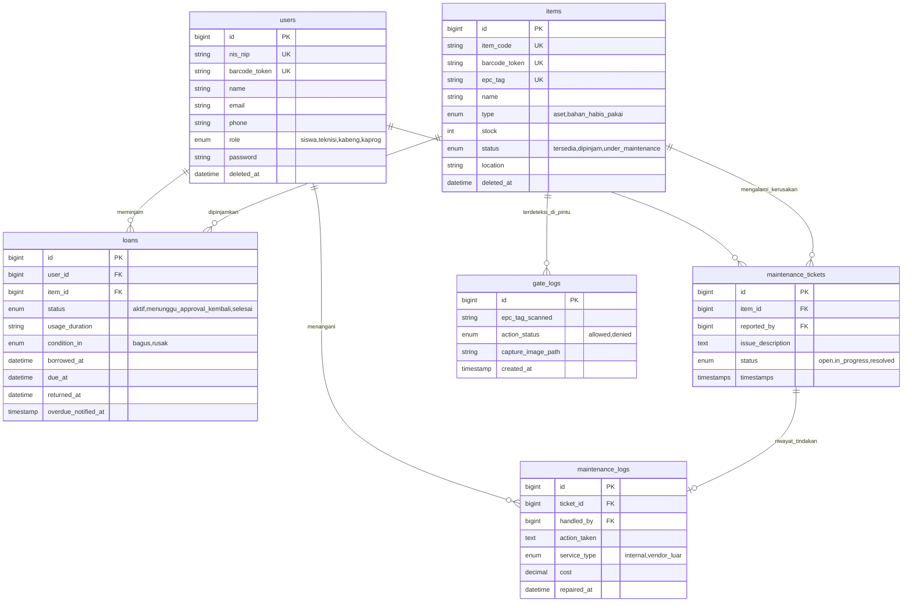

# SYSTEM SPECIFICATION — SILAMET
**Sistem Informasi Manajemen Inventarisasi Laboratorium Terintegrasi Gate Security UHF RFID & Modul Pemeliharaan**  
**Ruang Lingkup:** Laboratorium Jurusan Sistem Informasi, Jaringan, dan Aplikasi (SIJA) — SMK Negeri 1 Cibinong  
**Dokumen:** Spesifikasi Sistem Tunggal & Sumber Kebenaran (*Single Source of Truth / SSOT*)  
**Versi:** 3.0 (Konsolidasi PRD, Business Logic, Database Schema, UI/UX Design, & Status Implementasi)

---

## 1. RINGKASAN PRODUK & LATAR BELAKANG

### 1.1. Latar Belakang
Laboratorium Komputer & Jaringan SIJA SMKN 1 Cibinong mengelola ratusan aset praktikum berharga tinggi (seperti Router MikroTik, Switch Manageable, Fusion Splicer, Optical Power Meter, Tang Krimping, dan alat ukur jaringan). Pengelolaan manual rentan terhadap risiko kehilangan alat saat dibawa keluar lab tanpa izin, antrean panjang saat peminjaman alat di awal jam praktikum, serta minimnya pencatatan kondisi fisik dan riwayat pemeliharaan (*Maintenance & Repair*).

### 1.2. Tujuan Utama
1. **Self-Service Kiosk Cepat:** Memangkas waktu antrean peminjaman mandiri menjadi di bawah 5 detik per transaksi melalui pemindaian instan Kartu Pelajar (NIS/NIP) dan barcode/QR alat.
2. **Keamanan Otomatis Gate UHF RFID:** Mengamankan pintu lab dengan verifikasi status barang real-time (latensi < 300 ms). Barang yang berstatus sah (`dipinjam`) diizinkan keluar lab, sedangkan barang tanpa transaksi sah (`tersedia` atau `under_maintenance`) memicu sirine alarm 12V dan snapshot kamera pengawas.
3. **Digitalisasi M&R & Pelacakan Keterlambatan:** Mencatat tiket kerusakan otomatis saat pengembalian barang, mengisolasi alat rusak dari Kiosk, serta memantau peminjaman melewati batas waktu (*overdue*) langsung dari dashboard admin.

### 1.3. Arsitektur Teknologi Utama
- **Backend Framework:** Laravel 11.x (PHP 8.2+) dengan arsitektur REST API Sanctum & Eloquent ORM.
- **Basis Data:** MySQL (`db_silamet`) dengan integritas relasi foreign key dan fitur *Soft Deletes*.
- **Frontend Kiosk & Dashboard:** Blade Templates, Tailwind CSS v3, Alpine.js, Lucide/Heroicons SVG outline, serta HTML5 Webcam WebRTC / `html5-qrcode`.
- **Hardware Daemon:** Python 3 Serial Daemon (`hardware/gate_listener.py` menggunakan `pyserial`, OpenCV `cv2`, dan `requests`).
- **Mikrokontroler & Aktuator:** Arduino Uno Relay Controller di `COM4` mengendalikan Buzzer/Sirine 12V, terhubung dengan Integrated UHF RFID Reader (HW-VX6330, protokol ISO18000-6C EPC Gen2).

---

## 2. HAK AKSES PENGGUNA (ROLE-BASED ACCESS CONTROL)

Sistem menggunakan 4 tingkatan peran (*Role*) yang dikelola melalui middleware dan *Spatie Laravel Permission*:

| Peran (*Role*) | Akses Antarmuka | Metode Autentikasi | Wewenang & Hak Akses Utama |
| :--- | :--- | :--- | :--- |
| **Siswa** | Meja Kiosk Mandiri (`/kiosk`) | Scan Barcode/QR NIS pada Kartu Pelajar | Meminjam barang mandiri, mengembalikan barang, melapor kondisi fisik (*Bagus/Rusak*), serta menyimpan kontak telepon/WhatsApp untuk administrasi lab. Dilarang masuk web dashboard admin. |
| **Teknisi** | Web Admin (`/dashboard`) | NIP/Email + Password | Mengelola tiket pemeliharaan (`/maintenance`), mencatat log pengerjaan servis & biaya suku cadang, mengubah status barang pasca-perbaikan kembali menjadi `tersedia`. |
| **Kepala Bengkel (Kabeng)** | Web Admin (`/dashboard`) | NIP/Email + Password | Mengawasi ketersediaan aset lab, meninjau log pintu gerbang keamanan (`/gate-logs`), menyetujui jadwal pemeliharaan berkala, memantau pinjaman aktif. |
| **Kepala Program (Kaprog)** | Web Admin (`/dashboard`) | NIP/Email + Password | Mengakses seluruh laporan rekapitulasi inventaris, ringkasan pengeluaran biaya perbaikan (M&R), audit log keamanan pintu, serta ekspor laporan ke PDF dan Excel. |

---

## 3. INTEGRASI PERANGKAT KERAS & HARDWARE DAEMON

### 3.1. Kiosk Meja Layanan Mandiri
- **PC/Laptop Kiosk:** Menjalankan antarmuka Kiosk browser fullscreen.
- **USB HID Barcode Scanner:** Emulasi keyboard otomatis untuk membaca NIS kartu pelajar dan QR/Barcode alat. Dilengkapi sistem pembersih buffer otomatis (*auto-clear*) agar karakter scan berurutan tidak menempel (*concatenation*), serta autofocus halus.
- **Webcam Kiosk:** Mengambil foto wajah peminjam saat tombol konfirmasi ditekan sebagai bukti visual transaksi peminjaman.

### 3.2. Gerbang Keamanan Gate UHF RFID & Sirine
- **Integrated UHF RFID Reader HW-VX6330:** Terhubung via konverter RS232/RS485-to-USB serial (COM2/COM3) dengan antena polarisasi circular untuk mendeteksi stiker EPC Gen2 ISO18000-6C pada fisik alat yang melintasi kusen pintu lab.
- **Arduino Uno Relay Buzzer Controller:** Terhubung pada port serial `COM4` (9600 baud). Menerima perintah serial byte `'1'` / `'A'` dari Python Listener untuk memicu Relay menyalakan sirine 12V selama 2-3 detik saat terjadi pelanggaran.
- **Webcam Gate Security:** Kamera web di atas pintu yang otomatis mengambil snapshot foto pelanggar saat insiden penolakan (`denied`) terjadi.
- **Python Listener Daemon (`hardware/gate_listener.py`):**
  - Menerapkan *debounce window* (default 2.0 - 4.0 detik) untuk mencegah pembacaan berulang pada tag yang sama.
  - Mengirim payload ke API Laravel: `POST /api/v1/gate/check-tag` `{ "epc_tag": "<EPC_STRING>" }`.
  - Latensi komunikasi lokal LAN wajib di bawah 300 ms.

---

## 4. LOGIKA BISNIS & ATURAN SISTEM (CORE BUSINESS LOGIC)

### 4.1. Alur Peminjaman Kiosk Mandiri
1. **Identifikasi Peminjam:** Siswa memindai QR/Barcode NIS Kartu Pelajar di Layar Standby Kiosk. Sistem memvalidasi eksistensi siswa di tabel `users`.
2. **Validasi Nomor WhatsApp:** Kolom `users.phone` wajib terdaftar. Jika kosong, sistem menampilkan peringatan bahwa peminjaman terkunci dan siswa wajib melapor ke admin lab untuk melengkapi nomor kontak.
3. **Pemindaian Barang:** Siswa memindai barcode/QR alat. Barang harus berstatus `tersedia`. Alat yang berstatus `dipinjam` atau `under_maintenance` langsung ditolak dengan pesan spesifik.
4. **Pilihan Durasi Pemakaian:** Siswa memilih salah satu opsi durasi pemakaian:
   - `pulang_sekolah`: Jatuh tempo hari yang sama pukul 16:00 WIB.
   - `1_hari`: `borrowed_at + 1 hari` (jatuh tempo pukul 23:59 WIB).
   - `2_hari`: `borrowed_at + 2 hari` (jatuh tempo pukul 23:59 WIB).
   - `3_hari`: `borrowed_at + 3 hari` (jatuh tempo pukul 23:59 WIB).
   - `1_minggu`: `borrowed_at + 7 hari` (jatuh tempo pukul 23:59 WIB).
5. **Konfirmasi & Penguncian Status:** Saat tombol konfirmasi ditekan:
   - Webcam memotret wajah siswa (Base64 snapshot).
   - Dibuat baris data baru di tabel `loans` (relasi `user_id`, `item_id`, `usage_duration`, `due_at`, `borrowed_at`).
   - Status barang di tabel `items` otomatis berubah dari `tersedia` menjadi `dipinjam`.

### 4.2. Logika Pengambilan Keputusan Gate Security
Ketika tag EPC terdeteksi oleh reader pintu:
- **Kondisi `ALLOWED` (Akses Sah):**
  - Jika barang memiliki status `dipinjam`.
  - Respon API: `{"status": "allowed"}`. Sirine hening, tercatat di `gate_logs` dengan `action_status = 'allowed'`. Barang bebas dibawa keluar-masuk lab untuk kebutuhan praktikum.
- **Kondisi `DENIED` (Pelanggaran / Nyelonong):**
  - Jika barang berstatus `tersedia` (belum dipinjam di Kiosk) atau `under_maintenance` (sedang rusak/diisolasi), atau EPC tag tidak terdaftar.
  - Respon API: `{"status": "denied"}`. Python Listener mengirim sinyal ke Arduino Uno untuk menyalakan sirine 12V, webcam gerbang memotret wajah pelaku, dan data disimpan di `gate_logs` dengan `action_status = 'denied'` beserta path foto pelanggar.

### 4.3. Alur Pengembalian Mandiri & Pemeliharaan (M&R)
1. Siswa memilih menu **Pengembalian Barang** di Kiosk, memindai kartu NIS untuk memuat daftar pinjaman aktif miliknya.
2. Siswa memindai fisik barang yang dikembalikan dan memilih kondisi fisik:
   - **Kondisi `Bagus`:** Status pinjaman di tabel `loans` diperbarui menjadi `selesai`, kolom `returned_at` diisi timestamp sekarang, dan status barang di tabel `items` otomatis kembali menjadi `tersedia`.
   - **Kondisi `Rusak`:** Siswa wajib mengisi catatan kerusakan (minimal 3 karakter). Sistem otomatis membuat tiket baru di tabel `maintenance_tickets` (`status = 'open'`), status pinjaman menjadi `selesai`, dan status barang di tabel `items` langsung dikunci menjadi `under_maintenance` (alat seketika hilang dari katalog pinjaman Kiosk).
3. **Eksekusi Teknisi:** Teknisi membuka `/maintenance` di web dashboard, menekan tombol *Mulai Perbaikan* (`status = 'in_progress'`), mencatat tindakan teknis dan biaya di tabel `maintenance_logs`. Setelah uji kelayakan berhasil, teknisi menyelesaikan tiket (`status = 'resolved'`) dan status barang otomatis pulih kembali menjadi `tersedia`.

### 4.4. Pemantauan Keterlambatan Pengembalian (*Overdue Tracking*)
- **Pencatatan Jatuh Tempo:** Sistem menghitung dan menyimpan batas waktu pengembalian (`due_at`) secara presisi saat peminjaman diproses di Kiosk.
- **Deteksi Keterlambatan Real-time:** Setiap peminjaman berstatus `aktif` yang telah melewati batas jatuh tempo (`due_at < NOW()`) otomatis ditandai sebagai terlambat (*overdue*) pada sistem.
- **Pemantauan Terpadu di Dashboard:** Seluruh daftar peminjaman terlambat ditampilkan pada panel Dasbor Staf lengkap dengan durasi keterlambatan, nama siswa, dan nomor kontak/WhatsApp peminjam untuk kebutuhan koordinasi dan penagihan langsung oleh admin/staf lab.

---

## 5. SPESIFIKASI SKEMA BASIS DATA (DATABASE SCHEMA)

Seluruh tabel menggunakan engine InnoDB MySQL (`db_silamet`) dengan UTF8mb4 dan fitur *Soft Deletes* pada tabel-tabel master utama.



### 5.1. Rincian Kolom Tabel

#### Tabel: `users`
| Kolom | Tipe Data | Keterangan |
| :--- | :--- | :--- |
| `id` | BigInteger (PK, AI) | Identifier unik pengguna |
| `nis_nip` | String(50), Unique, Indexed | Nomor Induk Siswa/NIP untuk barcode scanner |
| `barcode_token` | String(20), Unique, Nullable | Token pendek QR Code kartu pelajar |
| `name` | String(100), Not Null | Nama lengkap pengguna |
| `email` | String, Nullable | Email login staf (siswa tidak wajib) |
| `phone` | String(20), Nullable | Nomor kontak/WhatsApp siswa untuk administrasi lab |
| `role` | Enum, Not Null | `'siswa'`, `'teknisi'`, `'kabeng'`, `'kaprog'` |
| `password` | String, Nullable | Password terenkripsi bcrypt (khusus staf) |
| `deleted_at` | Timestamp, Nullable | Soft Delete Eloquent |

#### Tabel: `items`
| Kolom | Tipe Data | Keterangan |
| :--- | :--- | :--- |
| `id` | BigInteger (PK, AI) | Identifier unik barang |
| `item_code` | String(50), Unique, Indexed | Kode inventaris barang (contoh: `SLM-001`) |
| `barcode_token` | String(20), Unique, Nullable | Token unik untuk QR Code stiker fisik alat |
| `epc_tag` | String(100), Unique, Nullable | Nilai HEX EPC stiker UHF RFID (Alien/Impinj) |
| `name` | String(100), Not Null | Nama alat (contoh: Router MikroTik RB951) |
| `type` | Enum, Not Null | `'aset'` (stok selalu 1), `'bahan_habis_pakai'` |
| `stock` | Integer, Default: 1 | Jumlah kuantitas stok |
| `status` | Enum, Default: `'tersedia'` | `'tersedia'`, `'dipinjam'`, `'under_maintenance'` |
| `location` | String(100), Not Null | Ruangan & penempatan rak (contoh: Lab SIJA - Rak A2) |
| `deleted_at` | Timestamp, Nullable | Soft Delete Eloquent |

#### Tabel: `loans`
| Kolom | Tipe Data | Keterangan |
| :--- | :--- | :--- |
| `id` | BigInteger (PK, AI) | Identifier unik transaksi peminjaman |
| `user_id` | ForeignId (`users.id`) | Peminjam barang |
| `item_id` | ForeignId (`items.id`) | Barang yang dipinjam |
| `status` | Enum, Default: `'aktif'` | `'aktif'`, `'menunggu_approval_kembali'`, `'selesai'` |
| `usage_duration` | String(30), Nullable | `'pulang_sekolah'`, `'1_hari'`, `'2_hari'`, `'3_hari'`, `'1_minggu'` |
| `condition_in` | Enum, Nullable | Kondisi saat kembali: `'bagus'`, `'rusak'` |
| `borrowed_at` | DateTime, Not Null | Waktu mulai dipinjam |
| `due_at` | DateTime, Nullable | Batas waktu pengembalian |
| `returned_at` | DateTime, Nullable | Waktu fisik alat dikembalikan |
| `overdue_notified_at` | Timestamp, Nullable | Flag timestamp (legacy/opsional) |

#### Tabel: `gate_logs`
| Kolom | Tipe Data | Keterangan |
| :--- | :--- | :--- |
| `id` | BigInteger (PK, AI) | Identifier unik log pembacaan gerbang |
| `epc_tag_scanned` | String(100), Indexed | Tag EPC yang terbaca antena HW-VX6330 |
| `action_status` | Enum, Not Null | Keputusan sistem: `'allowed'` atau `'denied'` |
| `capture_image_path` | String, Nullable | Lokasi penyimpanan foto webcam saat alarm menyala |
| `created_at` | Timestamp | Waktu deteksi RFID di pintu |

#### Tabel: `maintenance_tickets` & `maintenance_logs`
- `maintenance_tickets`: Mencatat laporan kendala fisik alat (`item_id`, `reported_by`, `issue_description`, `status`: `'open'`, `'in_progress'`, `'resolved'`).
- `maintenance_logs`: Riwayat pengerjaan teknisi (`ticket_id`, `handled_by`, `action_taken`, `service_type`: `'internal'` / `'vendor_luar'`, `cost`, `repaired_at`).

---

## 6. SPESIFIKASI ANTARMUKA PENGGUNA (UI/UX DESIGN)

### 6.1. Design System & Standar Visual
- **Palet Warna Utama (Sesuai `tailwind.config.js`):**
  - Primary: Modern Indigo (`#4F46E5`), Dark Indigo/Slate 900 (`#0F172A`), Soft Indigo (`#EEF2FF`).
  - Accent / Brand: Sky Blue (`#0EA5E9` / `#0284C7`).
  - Semantic Status:
    - **Emerald (`success` `#10B981`):** Barang tersedia, gate `allowed`, peminjaman berhasil.
    - **Rose/Red (`danger` `#EF4444`):** Pelanggaran gate `denied`, alarm sirine, alat rusak/terlambat.
    - **Amber (`warning` `#F59E0B`):** Barang dalam perbaikan (`under_maintenance`), masa tenggang.
    - **Cyan (`info` `#06B6D4`):** Scanner USB siaga, informasi sistem.
- **Tipografi:** Sans-serif tegas (`Inter`, `Outfit`, `Figtree`) untuk teks umum; `font-mono` untuk NIS/NIP, kode barang (`item_code`), token barcode, nilai EPC RFID, dan timestamp.
- **Ikonografi:** Outline SVG murni konsisten (Lucide/Heroicons, stroke-width 1.8 / 2). Tanpa ornamen AI seperti floating badges bertuliskan "✨ Powered by AI".

### 6.2. Alur Layar Kiosk Mandiri (`/kiosk`)
- **Layar 1 (Standby):** Visual animasi scanner siaga. Menerima scan barcode NIS Kartu Pelajar otomatis (autofocus loop) tanpa klik mouse. Terdapat tombol sekunder menuju Layar Pengembalian.
- **Layar 2 (Keranjang Peminjaman & Durasi):**
  - Menampilkan profil siswa dan jumlah item yang akan dipinjam.
  - Kartu pilihan durasi pemakaian berukuran sentuh besar (minimal 44px tinggi).
  - Peringatan instan jika siswa belum melengkapi nomor WhatsApp.
- **Layar 3 (Konfirmasi & Snapshot):**
  - Pratinjau stream webcam HTML5 WebRTC secara langsung.
  - Tombol konfirmasi hijau besar &rarr; Capture foto & kirim transaksi ke backend.
  - Audio feedback beep ganda dan kartu konfirmasi batas tanggal pengembalian sebelum reset otomatis dalam 3 detik.
- **Layar 4 (Pengembalian Mandiri Multi-Barang):**
  - Scan NIS peminjam untuk membuka daftar tanggungan alat miliknya.
  - Scan barcode alat atau tap kartu pinjaman untuk memasukkan ke daftar kembali.
  - Toggle tombol kondisi fisik: **Bagus** atau **Rusak** (wajib mengisi deskripsi kerusakan minimal 3 karakter untuk memicu tiket M&R).

### 6.3. Alur Web Dashboard Admin & Staf (`/dashboard`)
- **Dasbor Utama:** Statistik ringkas ketersediaan aset, grafik peminjaman mingguan, dan panel peringatan barang *overdue*.
- **Monitoring Gate Real-Time (`/gate-logs`):** Log pembacaan sensor pintu dengan warna hijau (`allowed`) dan merah (`denied`), disertai modal klik untuk melihat foto snapshot webcam pelaku pelanggaran.
- **Modul Pemeliharaan (`/maintenance`):** Tab tiket terbuka (`open`), form eksekusi servis (`in_progress`), dan tombol restorasi kelayakan alat kembali ke status `tersedia`.
- **Cetak Label & Kartu:** Format cetak barcode & QR code horizontal ringkas untuk ditempel pada alat dan kartu pelajar A4.

---

## 7. STATUS IMPLEMENTASI & VERIFIKASI PENGUJIAN

### 7.1. Komponen yang Telah Selesai
- [x] **Skema Basis Data & Model Eloquent:** Seluruh migrasi, soft deletes, enum, dan seeder laboratorium selesai.
- [x] **REST API Endpoints:** Sanctum-ready untuk autentikasi Kiosk, transaksi pinjam/kembali, tiket M&R, dan API Gate Security (`/api/v1/gate/check-tag`).
- [x] **Antarmuka Kiosk Mandiri Touch-Friendly:** Selesai di `resources/views/kiosk/index.blade.php` dengan penanganan buffer anti-concatenation, webcam snapshot WebRTC, dan selector durasi peminjaman.
- [x] **Hardware Listener Daemon:** Script Python `hardware/gate_listener.py` dan simulator `hardware/simulate_gate.py` selesai dan terintegrasi dengan relay Arduino Uno COM4.
- [x] **Automated Test Suite:** 100% lulus (**94 passed tests, 263 assertions**) via `php artisan test`.
- [x] **MCP Toolbox Configuration:** Terkonfigurasi pada `db_config.yaml` untuk inspeksi database MySQL terkontrol.

### 7.2. Panduan Menjalankan Sistem Lokal
1. **Menjalankan Web Server & Kiosk:**
   ```powershell
   php artisan serve --port=8000
   ```
   Akses Kiosk di browser: `http://127.0.0.1:8000/kiosk` (disarankan Chrome/Edge dengan parameter `--kiosk`).
2. **Menjalankan Hardware Daemon Gate:**
   ```powershell
   python hardware/gate_listener.py --port COM2 --baud 57600 --mode answer --debounce 3.0
   ```
   *(Gunakan opsi `--simulate` jika menguji tanpa kabel fisik reader).*
3. **Menjalankan Pengujian Otomatis:**
   ```powershell
   php artisan test
   ```

